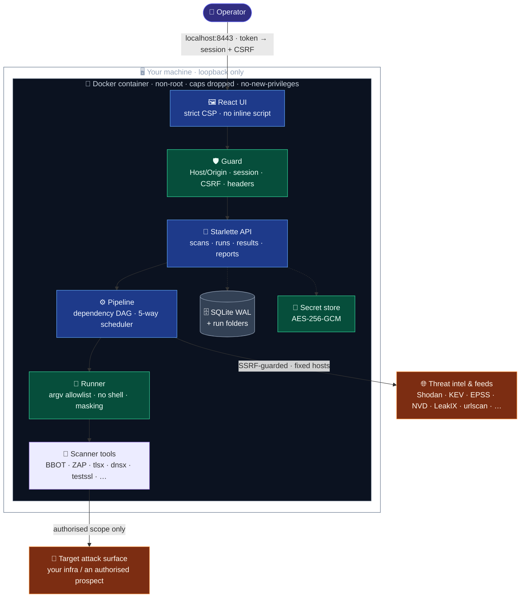

# Outsider ASM

**A local, single-operator external attack-surface-management app.** Point it at a domain you're authorised to test and it discovers the internet-facing estate, runs a passive / light-touch scan pipeline of best-in-class open-source tools, enriches findings with threat intelligence, models kill-chain attack paths, and produces board-to-engineering reports — all inside one Docker container on your machine, bound to loopback.

<p>


</p>

> **Status: milestones 1–6 of 7.** Discovery & scope, authorisation, the light-touch pipeline (parallel stages, live view, pause/resume, ZAP host picker), results (overview with RAG, surface map, trends, attack paths, assets, IPs, DNS, findings with embedded evidence, triage, file browser) and reports (a full document plus a redacted share-zip). Next: AI providers (M7).

## What it does

- **Discovers** your external footprint passively — subdomains, related domains, DNS, certificates, cloud assets — before touching a single target server.
- **Scans light-touch by default** — one front-page request per host, TLS and DNS posture, email/brand spoofing exposure, technology versions. Anything that sends attack traffic (port scanning, ZAP active, vuln probes) is **off by default, authorisation-gated, and confirmed per stage**.
- **Enriches** every finding with authoritative intel: CISA KEV, FIRST EPSS, NVD/CVSS, CWE, OWASP, NIST SP 800-53, plus breach exposure and end-of-life version currency.
- **Models attack paths** as kill chains (MITRE ATT&CK / ATLAS), including the AI-agent / MCP surface — theoretically, reasoning over collected exposure without sending traffic.
- **Reports** with a RAG verdict, a surface map, trend-vs-last-scan, and a redacted share pack safe to hand to a vendor, insurer or the board.

Built for security teams to review **their own** infrastructure, and for consultants to run authorised pre-engagement reviews.

## Demo

> 🔗 **[Live demo (redacted)](https://high5ive-64.github.io/asm-console/)** — the full results UI running against a frozen, redacted snapshot of a real scan. No backend, nothing sensitive.

The demo is the real results experience — RAG verdict, surface map, attack paths / kill chains, technologies and versions, CVE and MITRE ATT&CK/ATLAS mappings, findings with evidence — run against [pentest-ground.com](https://pentest-ground.com), a public penetration-testing practice range. Every host name, IP and email is pseudonymised (`asset-01`, `ip-07`, `email-01`) by the same redactor used for the share pack; standards references (MITRE, CWE, OWASP, NVD, EPSS, CISA KEV) are preserved so the mappings stay clickable. It is a point-in-time export, so report generation and raw-evidence files are disabled.

The same snapshot also powers the in-app **Demo** tab (`/demo`), so you can show the tool without exposing a live scan.

## Architecture



Every command a stage runs is built as an argument list (never a shell string) and checked against an allowlist before execution; outbound fetches are guarded against SSRF; secrets are encrypted at rest and masked out of logs.

## Run it

Requirements: Docker Desktop (or OrbStack) on macOS, plus about 6 GB of free RAM for scans.

```bash
cp Makefile.dist Makefile   # one-time
make build      # first build takes a while: ZAP, Firefox, Java, BBOT and its module dependencies
make up         # starts on http://localhost:8443 and prints the access token on first start
```

Open <http://localhost:8443> and paste the token. Lost it? Run `make token`.

Other commands: `make logs`, `make down`, `make test`, `make versions` (tool versions inside the image), `make smoke` (checks every tool runs).

## Tools & integrations

All open-source, pinned in `docker/versions.env`, and allowlist-gated. Passive / DNS-only / light-touch unless a switch explicitly opts into active traffic.

| Area | Engines & services | Traffic |
|---|---|---|
| **Discovery & enumeration** | BBOT (passive modules), certificate transparency (crt.sh), DNS resolvers; optional keyed datasets: Censys, SecurityTrails, VirusTotal, Chaos, GitHub, WhoisXML | passive / DNS-only |
| **Web & TLS** | OWASP ZAP (passive crawl; active opt-in), tlsx, testssl.sh, Wappalyzer rules (tech + versions), gau (historical URLs), uro | light-touch |
| **DNS & takeover** | dnsx, dig, dnsReaper, cdncheck (CDN/WAF/cloud), BBOT baddns | DNS-only |
| **Email & brand** | checkdmarc (SPF/DMARC/MTA-STS/TLS-RPT/BIMI), dnstwist, openSquat (lookalikes) | DNS-only |
| **Exposure & threat intel** | Shodan / InternetDB, Shodan CVEDB, LeakIX, Netlas, urlscan.io, CISA KEV, FIRST EPSS, NVD, endoflife.date, XposedOrNot, Have I Been Pwned | none (fixed-host API calls) |
| **Cloud inventory** | cloudlist (AWS, GCP, Azure, Cloudflare, DigitalOcean — read-only) | none |
| **Screenshots & reporting** | Firefox + geckodriver (gowitness), Typst (PDF) | light-touch |
| **Optional sidecar** | SpiderFoot (passive use case only) | none |

Breach exposure stays domain-level by default; harvested emails are listed on the Overview, and a per-email breach check unlocks only once a domain is already flagged.

**Active switches** (off by default, warned, authorisation-gated, confirmed per stage): naabu port scan, ZAP active scan, testssl.sh vulnerability probes, openSquat port check, dnstwist lookalike probes, SpiderFoot non-passive use cases, STARTTLS mail test.

SpiderFoot: `docker compose --env-file docker/versions.env --profile spiderfoot up -d` — its own UI on `127.0.0.1:5001` has no login and can run active modules, so use it for viewing only.

## Results

When a scan finishes, its **Results** step opens with ten tabs:

- **Overview** — the RAG verdict and its reasons, a surface map (issue treemap + attack-path graph), a worst-first worklist, metric cards with trend vs the previous scan, a vulnerability version-confidence matrix, discovered emails, and the agent / MCP surface. An **"Incomplete scan"** banner appears if any stage failed, so a green rating is never mistaken for a clean bill.
- **Changes** — new/removed hosts, ports opened/closed, new/resolved findings and RAG movement vs any earlier scan.
- **Assets** — every in-scope host: status, IPs, technology & versions, TLS expiry, ports, CMDB/third-party/CDN flags, issue counts, screenshots.
- **IPs** — resolved IPs, their services, and the hosts sharing each one.
- **DNS** — every resolved record (A/AAAA, CNAME, NS/MX, TXT, CAA).
- **Attack paths** — kill chains with precondition, impact, assets, MITRE ATT&CK/ATLAS links, agent-risk tags, likelihood and remediation. Theoretical only.
- **Findings** — grouped by issue, each with structured evidence and authoritative references; mark observation / verified / false positive.
- **Triage** — hosts not in your CMDB; decide what each is. Undecided = unknown (amber).
- **Files** — read-only browser of the run folder (HTML downloads rather than opens, since tool output can be hostile).
- **Reports** — a full board-to-engineering document, plus a **redacted share-zip** (hosts/IPs → `asset-01`/`ip-07`, IPv6 and emails included) safe to send outside the team.

RAG rules: **red** for a risky service, dangling DNS, expired cert or high ZAP alert; **amber** for unknown hosts, no DMARC reject, medium ZAP alerts or certs expiring within 30 days.

## Security

### Inbuilt protections

- **Loopback only.** Published to `127.0.0.1`; requests are rejected unless the `Host` header is `localhost`/`127.0.0.1` (blocks DNS rebinding), and cross-site `Origin`s are rejected.
- **Auth.** One-time access token → `HttpOnly`, `SameSite=Strict` session cookie; every state-changing request needs a CSRF token.
- **Strict CSP**, no inline script or style; React escapes all scan-derived text; reports download rather than render.
- **Secrets** are AES-256-GCM encrypted at rest (key name bound as associated data), never returned by the API, and masked out of every log line. The master key is generated on first run and kept in `secrets/master.key` with `0600` (owner-only) permissions; `secrets/` is git-ignored, so the key never enters the repo.
- **Command execution** is allowlist-gated: every argv is validated (binary, flags, numeric ranges, file paths confined to the run folder) and run without a shell. Credential brute-forcers and raw port scanners are blocked *and absent from the image*.
- **Outbound fetches** are SSRF-guarded — per-host requests and redirects are refused if the target resolves to a loopback, link-local (incl. cloud-metadata), private or reserved address.
- **Active traffic** can't run without a completed, SOC-notified authorisation record, and each active stage requires an explicit per-stage confirmation.
- **Container** runs as a non-root user with all Linux capabilities dropped and `no-new-privileges`.

### Standards & frameworks

Findings and attack paths are mapped to, and deep-linked against, authoritative sources (the UI never constructs a reference URL itself):

**NVD / CVSS · CISA KEV · FIRST EPSS · CWE · OWASP Top 10 · OWASP LLM Top 10 · NIST SP 800-53 · MITRE ATT&CK · MITRE ATLAS**

### CI & quality gates

GitHub Actions runs on every push / PR to `main` (`.github/workflows/ci.yml`):

A **gate** fails the build and blocks merge; **advisory** steps run and report but don’t block.

| Job (runner) | Step | Exactly what runs | |
|---|---|---|---|
| **backend** · Python 3.12 | Tests | `python -m pytest -q` — full suite, 191 tests | ✅ gate |
| | Dependency audit | `pip-audit -r backend/requirements.txt` | advisory |
| **frontend** · Node 20 | Typecheck | `npx tsc --noEmit` | advisory |
| | Build | `node build.mjs` — esbuild production bundle | ✅ gate |
| | Dependency audit | `npm audit` | advisory |
| **secrets** | Secret scan | `gitleaks-action@v2` over full history, config `.gitleaks.toml` | ✅ gate |

A local **gitleaks pre-commit hook** (`.githooks/pre-commit`, config in `.gitleaks.toml`) catches secrets before they're committed. See `DEV.md` for the dev loop.

## What's where

| Path | Purpose |
| --- | --- |
| `backend/asm/allowlist.py` | Every command the app runs is checked here first |
| `backend/asm/scope.py` | Domain validation and the single `in_scope()` filter |
| `backend/asm/security.py` | Access token, sessions, CSRF, Host/Origin checks, security headers |
| `backend/asm/secrets_store.py` | AES-256-GCM encrypted, write-only API keys |
| `backend/asm/discovery.py` | Passive discovery + the SSRF-guarded HTTP client |
| `backend/asm/pipeline.py` | Stage definitions, dependency DAG and the parallel scheduler |
| `backend/asm/extras.py` | The extra non-invasive sources (breach exposure, KEV/EPSS, lookalikes, urlscan, cloud…) |
| `backend/asm/attackpaths.py` | Derives kill-chain attack paths (MITRE ATT&CK / ATLAS) — theoretical, sends no traffic |
| `backend/asm/evidence.py` | Maps each finding to its structured per-tool evidence |
| `backend/asm/reports.py` | Builds the Typst reports (full document and redacted share-zip) |
| `backend/asm/report_refs.py` | Canonical reference URLs (NVD/KEV/EPSS, CWE, OWASP, NIST, MITRE) |
| `backend/asm/runner.py` | Runs allowlisted commands, streams masked output, handles cancel/timeouts |
| `backend/tests/` | 191 tests: unit (allowlist, scope, crypto, SSRF, redaction) + integration (full pipeline with stubbed tools) |
| `frontend/src/` | React + TypeScript UI, bundled by esbuild |
| `docker/` | Dockerfile and pinned tool versions |
| `data/` | Database, run folders, exports — created on first start (git-ignored) |
| `secrets/master.key` | Encrypts your API keys (mode 600). Back it up with `data/` or saved keys can't be decrypted |

## Running a scan

1. **New scan** — enter the domain, pick discovery sources, review and confirm the scope.
2. **Authorisation** — record who approved the test, the reference, the window, your source IP and SOC awareness. Saved with the run as audit evidence.
3. **Options** — choose stages (labelled *no traffic* / *DNS only* / *light-touch*), set ZAP/TLS limits, optionally add public IPs. The estimate updates live.
4. **Review → Start.** You can close the tab; the scan runs in the container. **Cancel** stops cleanly, **Resume** continues from the first unfinished stage, **Retry** re-runs one failed stage.
5. Run files live in `data/runs/<date>-<id>/` (scope snapshot, `authorisation.json`, per-stage logs, raw tool output).

Downstream stages loop back to pick up hosts found after the initial sweep; hosts that no longer resolve are recorded as historical rather than dropped. A container restart mid-scan marks the scan *interrupted* and it can be resumed.

## Tests

`make test` runs the full suite (191 tests) inside the image; the same tests gate every push in CI. Bare/stubbed runs and the dev loop are in [DEV.md](DEV.md).


## Roadmap

Built in milestones; **1–6 of 7 are done** — discovery & scope, authorisation, the light-touch pipeline, results, and reports.

**Next — M7: AI providers.** Optional AI-assisted analysis and triage over scan data, plus modelling of the AI-agent / MCP attack surface (OWASP LLM Top 10, MITRE ATLAS). Guardrails-first by design: provider keys live in the encrypted secret store, agent permissions are least-privilege, no secret egress, and every action is auditable — consistent with the theoretical-only approach the attack-path engine already takes (reason over exposure, send no traffic).

Full change history and what's planned next: **[CHANGELOG.md](CHANGELOG.md)**.

## Open-source tools & data sources

Outsider ASM is a thin, safety-focused orchestration layer over established open-source projects and public data sources. Full credit to their authors and maintainers.

**Built with** — [Starlette](https://www.starlette.io/) · [Uvicorn](https://www.uvicorn.org/) · [React](https://react.dev/) · [TypeScript](https://www.typescriptlang.org/) · [esbuild](https://esbuild.github.io/) · [Typst](https://typst.app/) · [cryptography](https://cryptography.io/) · [SQLite](https://www.sqlite.org/)

**Discovery & enumeration** — [BBOT](https://github.com/blacklanternsecurity/bbot) · [crt.sh](https://crt.sh/) (certificate transparency)

**Web & TLS** — [OWASP ZAP](https://www.zaproxy.org/) · [tlsx](https://github.com/projectdiscovery/tlsx) · [testssl.sh](https://github.com/drwetter/testssl.sh) · [gau](https://github.com/lc/gau) · [uro](https://github.com/s0md3v/uro) · [Wappalyzer fingerprints](https://github.com/wappalyzer/wappalyzer)

**DNS & takeover** — [dnsx](https://github.com/projectdiscovery/dnsx) · [DNSReaper](https://github.com/punk-security/dnsReaper) · [cdncheck](https://github.com/projectdiscovery/cdncheck) · [baddns](https://github.com/blacklanternsecurity/baddns)

**Email & brand** — [checkdmarc](https://github.com/domainaware/checkdmarc) · [dnstwist](https://github.com/elceef/dnstwist) · [openSquat](https://github.com/atenreiro/opensquat)

**Cloud inventory** — [cloudlist](https://github.com/projectdiscovery/cloudlist)

**Screenshots & reporting** — [gowitness](https://github.com/sensepost/gowitness) · [geckodriver](https://github.com/mozilla/geckodriver) · [Firefox](https://www.mozilla.org/firefox/) · [Typst](https://github.com/typst/typst)

**Exposure & threat intelligence** — [Shodan InternetDB](https://internetdb.shodan.io/) · [Shodan CVEDB](https://cvedb.shodan.io/) · [LeakIX](https://leakix.net/) · [Netlas](https://netlas.io/) · [urlscan.io](https://urlscan.io/) · [CISA KEV](https://www.cisa.gov/known-exploited-vulnerabilities-catalog) · [FIRST EPSS](https://www.first.org/epss/) · [NVD](https://nvd.nist.gov/) · [endoflife.date](https://endoflife.date/) · [XposedOrNot](https://xposedornot.com/) · [Have I Been Pwned](https://haveibeenpwned.com/)

**Standards & frameworks** — [MITRE ATT&CK](https://attack.mitre.org/) · [MITRE ATLAS](https://atlas.mitre.org/) · [CWE](https://cwe.mitre.org/) · [OWASP Top 10](https://owasp.org/Top10/) · [OWASP LLM Top 10](https://genai.owasp.org/) · [NIST SP 800-53](https://csf.tools/reference/nist-sp-800-53/) · [CVSS](https://www.first.org/cvss/)

**Optional sidecar** — [SpiderFoot](https://github.com/smicallef/spiderfoot)

Optional keyed datasets (bring your own API key): Censys, SecurityTrails, VirusTotal, [Chaos](https://chaos.projectdiscovery.io/), GitHub, WhoisXML.
